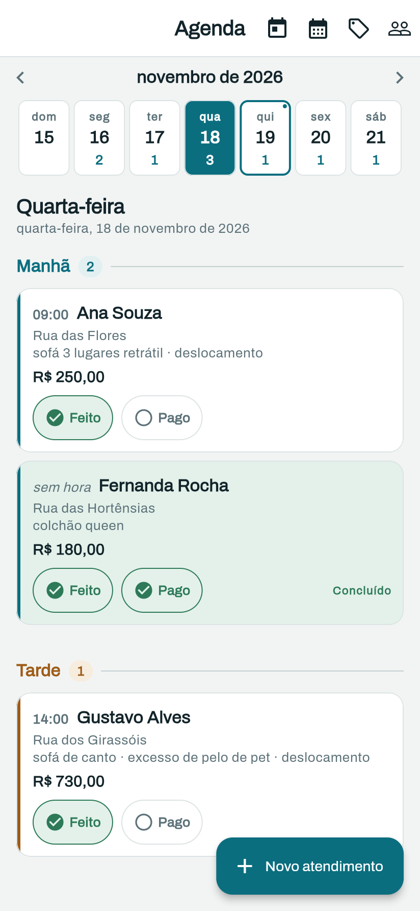
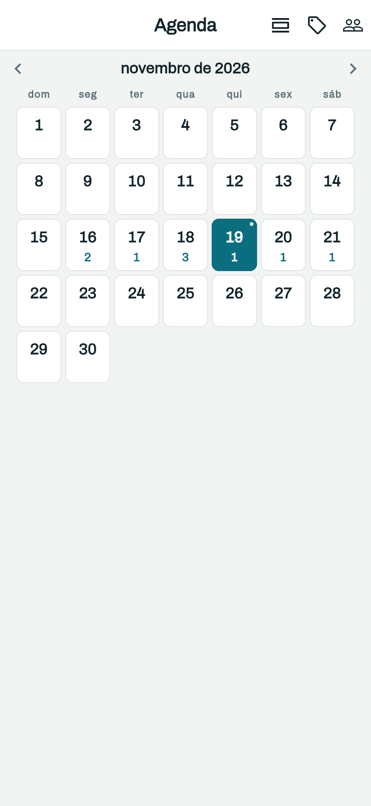
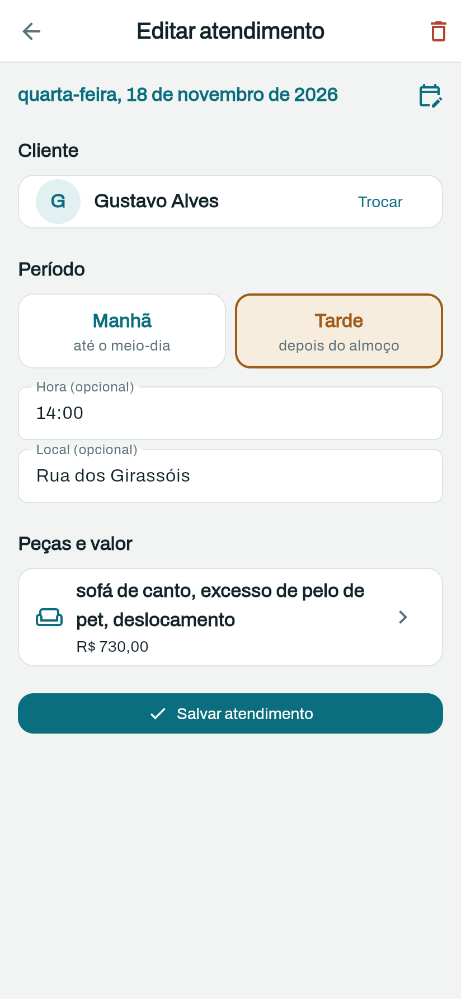
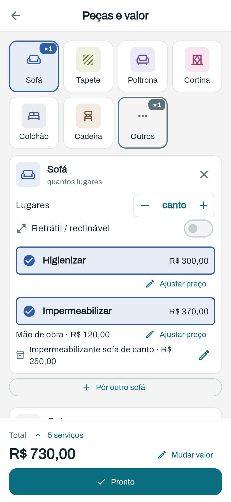
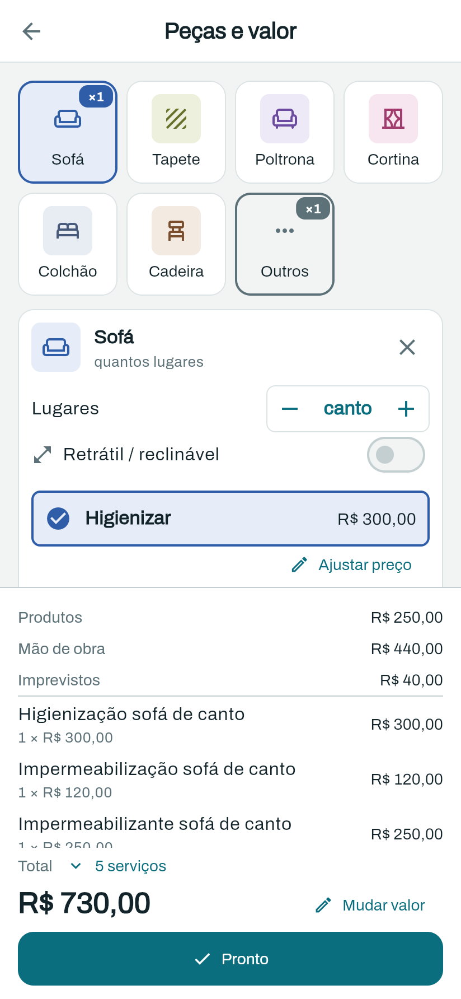
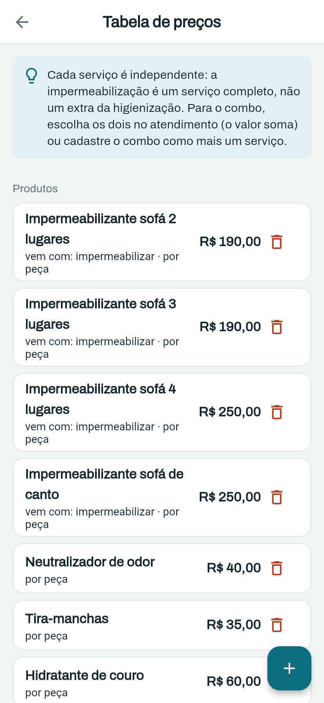
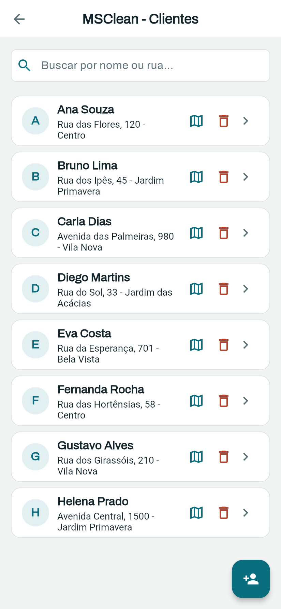
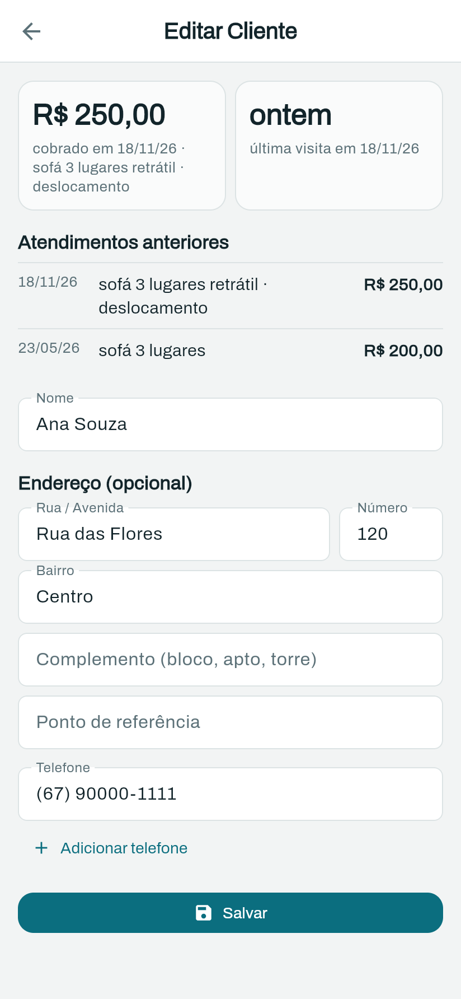

# SGC para MSClean

**A agenda de papel de uma empresa de higienização de estofados e tapetes, virada aplicativo.** Flutter + Supabase, feito para uma usuária real: a proprietária da MSClean, que **usa o app no dia a dia desde novembro de 2026**.

> Os prints abaixo saem do **modo demonstração**, com dados fictícios: nenhum cliente real aparece neste repositório.

<table>
  <tr>
    <td align="center" valign="top" width="25%"><br><sub><b>Agenda do dia</b><br>semana no topo, manhã e tarde, feito e pago no cartão<br><a href="docs/requisitos.md#rf-010---agenda-por-data">RF-010</a> · <a href="docs/requisitos.md#rf-014---estados-de-conclusão-do-atendimento">RF-014</a> · <a href="docs/requisitos.md#4-histórias-de-usuário-user-stories">HU 6</a></sub></td>
    <td align="center" valign="top" width="25%"><br><sub><b>Visão do mês</b><br>quantos atendimentos em cada dia<br><a href="docs/requisitos.md#rf-010---agenda-por-data">RF-010</a> · <a href="docs/requisitos.md#4-histórias-de-usuário-user-stories">HU 6</a></sub></td>
    <td align="center" valign="top" width="25%"><br><sub><b>Registrar atendimento</b><br>cliente e período bastam<br><a href="docs/requisitos.md#rf-005---registrar-atendimento">RF-005</a> · <a href="docs/requisitos.md#4-histórias-de-usuário-user-stories">HU 5</a></sub></td>
    <td align="center" valign="top" width="25%"><br><sub><b>Peças e valor</b><br>peça, lugares e serviços sem digitar<br><a href="docs/requisitos.md#rf-013---tabela-de-preços-e-cálculo-do-valor">RF-013</a> · <a href="docs/requisitos.md#4-histórias-de-usuário-user-stories">HU 9</a></sub></td>
  </tr>
  <tr>
    <td align="center" valign="top" width="25%"><br><sub><b>Total por grupo</b><br>produtos, mão de obra e imprevistos<br><a href="docs/requisitos.md#rf-013---tabela-de-preços-e-cálculo-do-valor">RF-013</a> · <a href="docs/requisitos.md#4-histórias-de-usuário-user-stories">HU 9</a></sub></td>
    <td align="center" valign="top" width="25%"><br><sub><b>Tabela de preços</b><br>ela mantém; o produto vem com o serviço<br><a href="docs/requisitos.md#rf-013---tabela-de-preços-e-cálculo-do-valor">RF-013</a> · <a href="docs/requisitos.md#4-histórias-de-usuário-user-stories">HU 9</a></sub></td>
    <td align="center" valign="top" width="25%"><br><sub><b>Clientes</b><br>busca por nome ou rua, endereço no Maps<br><a href="docs/requisitos.md#rf-003---visualização-da-lista">RF-003</a> · <a href="docs/requisitos.md#rf-004---busca">RF-004</a> · <a href="docs/requisitos.md#rf-009---abrir-endereço-no-mapa">RF-009</a> · <a href="docs/requisitos.md#4-histórias-de-usuário-user-stories">HU 2</a></sub></td>
    <td align="center" valign="top" width="25%"><br><sub><b>Histórico do cliente</b><br>quanto cobrou e a última visita<br><a href="docs/requisitos.md#rf-011---consultar-o-histórico-de-um-cliente">RF-011</a> · <a href="docs/requisitos.md#4-histórias-de-usuário-user-stories">HU 7</a></sub></td>
  </tr>
</table>

Cada print aponta para o requisito (RF) e a história de usuário (HU) que ele atende em [`docs/requisitos.md`](./docs/requisitos.md); de lá, a [matriz de rastreabilidade](./docs/matriz-rastreabilidade.md) leva aos casos de teste e aos testes automatizados.

## O problema

A proprietária anotava cada atendimento num caderno: dia, cliente, endereço e as peças do serviço. O valor combinado ficava espalhado em conversas de WhatsApp e Instagram.

O projeto começou como um cadastro de clientes. Um levantamento de campo em 2026-09-10 (entrevista e fotos das páginas reais do caderno) mostrou que organizar contatos não era a dor. A dor era a **lacuna de transcrição** entre onde o preço é combinado e onde a data é anotada; foi dela que veio o agendamento duplicado que ela relatou. O centro do produto passou a ser a **agenda por data**, e o resto existe para apoiá-la. O registro completo está em [`docs/requisitos.md`](./docs/requisitos.md) §2.2.

## O que o app faz

- **Agenda por data** (RF-010): abre no dia de hoje, com semana e mês; atendimentos por manhã e tarde, com ou sem hora.
- **Registro rápido** (RF-005): cliente e período bastam; peças e valor são opcionais. Cliente novo pode vir dos **contatos do celular** (RF-016).
- **Feito e pago** (RF-014): dois estados independentes, marcados no próprio cartão; concluído só com os dois.
- **Tabela de preços e cálculo** (RF-013): serviços independentes (impermeabilizar não é extra de higienizar), preço por peça, lugares, tamanho e m², retrátil como acréscimo, produto que vem junto com o serviço, ajuste por item com justificativa e total por grupo.
- **Histórico do cliente** (RF-011): quanto foi cobrado e quando foi a última visita.
- **Funciona sem internet** (RNF-007): a agenda abre com o que está guardado no aparelho, e o que ela anota fica numa fila e é enviado quando a conexão volta.
- **Avisos no celular** (RF-015): resumo da véspera e do dia, aviso uma hora antes e lembrete de cobrança.
- **Clientes** (RF-001 a RF-004, RF-008, RF-009): cadastro com endereço estruturado e vários telefones, busca por relevância e endereço no Google Maps.

## Como foi feito

Desenvolvedor solo, com uma usuária real e um processo que deixa rastro:

- **Requisitos antes do código.** [`docs/requisitos.md`](./docs/requisitos.md) é a fonte da verdade. Cada critério de aceitação vira caso de teste ([`casos-de-teste.md`](./docs/casos-de-teste.md)) e linha na [matriz de rastreabilidade](./docs/matriz-rastreabilidade.md).
- **Teste antes.** O commit do teste vermelho vem separado do commit da implementação; o histórico mostra o vermelho e o verde. São **241 testes** automatizados (unidade e widget).
- **CI como gate.** `analyze + test` no GitHub Actions; a `main` é protegida e só recebe PR com o CI verde.
- **Teste manual registrado.** Cada entrega vai para uma pilha de verificação no celular, e cada rodada vira uma execução registrada em [`execucoes-de-testes-manuais.md`](./docs/execucoes-de-testes-manuais.md). Telas novas só entram depois do ok manual.
- **Gerência de configuração.** Branches, Conventional Commits, template de PR e documentação sincronizada no mesmo PR ([`gerencia-de-configuracao.md`](./docs/gerencia-de-configuracao.md)).
- **Design system** em código ([`lib/theme/`](./lib/theme)): as telas não usam cor literal, e um teste reprova quem usar.

## ⚙️ Arquitetura e tecnologia

- **Flutter** (Android; web para desenvolvimento e demonstração) com **Dart**.
- **Supabase** (PostgreSQL gerenciado, realtime e Row Level Security) como backend.
- **Offline-first leve:** um espelho local (`shared_preferences`) guarda as listas e uma fila de envio com `upsert` idempotente, para não duplicar nada quando a resposta se perde.
- **Notificações locais** agendadas a partir da própria agenda.

Decisões técnicas, schema e fluxo de dados em [`docs/arquitetura.md`](./docs/arquitetura.md).

## ▶️ Experimente sem banco: modo demonstração

O app inteiro com dados fictícios em memória, sem `.env` e sem Supabase. É de onde saem os prints acima.

```bash
fvm flutter pub get
fvm flutter run -d chrome -t lib/main_demo.dart
```

O que você fizer na demonstração some ao fechar. Os dados ficam em [`lib/demo/`](./lib/demo).

## 🛠️ Instalar e executar com o Supabase

O Flutter é fixado via **[FVM](https://fvm.app/)** (`.fvmrc`: Flutter 3.35.0 / Dart 3.9.0). Use sempre `fvm flutter`.

```bash
dart pub global activate fvm            # instala o FVM
git clone https://github.com/WilsonGorosthides/sgc_msclean.git
cd sgc_msclean
fvm use                                 # baixa a versão do .fvmrc
cp .env.example .env                    # preencha SUPABASE_URL e SUPABASE_ANON_KEY
fvm flutter pub get
fvm flutter run -d chrome
fvm flutter test                        # a suíte inteira
```

> **Pré-requisito:** um projeto **Supabase** com as tabelas `clientes`, `atendimentos` e `precos` e o RLS configurados. O schema está em [`docs/arquitetura.md`](./docs/arquitetura.md) §4.

## 📁 Estrutura do projeto

```
sgc_msclean/
├── lib/
│   ├── main.dart            # o app real (Supabase via .env)
│   ├── main_demo.dart       # modo demonstração (dados fictícios)
│   ├── demo/                # serviço em memória e dados de exemplo
│   ├── models/              # atendimento, peça, cliente, endereço, item de preço
│   ├── screens/             # agenda (inicial), atendimento, peças e valor, clientes, tabela
│   ├── services/            # Supabase, espelho e fila local, avisos, contatos, Maps
│   ├── theme/               # design system: cores, espaçamento, tipografia
│   ├── utils/               # agenda, cálculo do valor, histórico, avisos
│   └── widgets/             # seletor de peças e rodapé do total
├── test/                    # unidade e widget
└── docs/                    # requisitos, arquitetura, testes, GCS e prints
```

## 📚 Documentação

- [`requisitos.md`](./docs/requisitos.md): requisitos funcionais e não funcionais (fonte da verdade).
- [`arquitetura.md`](./docs/arquitetura.md): arquitetura, schema e decisões técnicas.
- [`design-system.md`](./docs/design-system.md): tokens visuais e componentes.
- [`plano-de-testes.md`](./docs/plano-de-testes.md): estratégia e níveis de teste.
- [`casos-de-teste.md`](./docs/casos-de-teste.md) e [`matriz-rastreabilidade.md`](./docs/matriz-rastreabilidade.md): critério ↔ caso de teste ↔ teste automatizado.
- [`execucoes-de-testes-manuais.md`](./docs/execucoes-de-testes-manuais.md): rodadas de teste manual no celular.
- [`gerencia-de-configuracao.md`](./docs/gerencia-de-configuracao.md): branches, commits, PRs e definição de pronto.
- **Protótipo navegável** da agenda, feito antes do código para validar o fluxo com a usuária: **[wilsongorosthides.github.io/sgc_msclean](https://wilsongorosthides.github.io/sgc_msclean/)**.

## 📈 Próximos passos

- **Orçamento** (RF-017, [#125](https://github.com/WilsonGorosthides/sgc_msclean/issues/125)): montar pela tabela, mandar pelo WhatsApp com nota em PDF e, aprovado, já cair na agenda.
- **Tipo de tecido** com acréscimo na tabela ([#138](https://github.com/WilsonGorosthides/sgc_msclean/issues/138)).
- **Aviso de conflito de horário** (RF-012).
- **Autenticação** (RF-007), antes de abrir o app para mais de uma usuária.

## 📜 Licença
Este projeto está licenciado sob a licença MIT — ver [`LICENSE`](./LICENSE).
