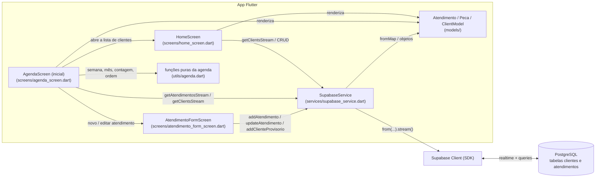

# Documento de Arquitetura e Decisões Técnicas - SGC para MSClean

## 1. Introdução
Este documento detalha a arquitetura de software, a stack de tecnologia (conjunto de tecnologias) e as decisões técnicas tomadas para o desenvolvimento do Sistema de Gestão de Clientes (SGC) da MSClean.

A stack oficial é **Flutter + Supabase**, confirmada na auditoria inicial (`docs/AUDITORIA_INICIAL.md`). Versões anteriores deste documento descreviam Firebase; essa divergência foi corrigida aqui.

## 2. Visão Geral da Arquitetura
O sistema segue um modelo **Cliente-Servidor (Backend as a Service)**. Um front-end multiplataforma se comunica com um serviço de backend gerenciado, eliminando a necessidade de construir e operar um servidor customizado.

* **Front-end (Cliente):** Um aplicativo Flutter que roda em Android e na Web.
* **Backend (BaaS):** O **Supabase**, responsável pelo banco de dados PostgreSQL gerenciado, sincronização em tempo real (realtime) e autorização via Row Level Security (RLS).

**Fluxo de Dados:**
```
[App Android / Web]  <==>  [Supabase Client]  <==>  [PostgreSQL (Supabase)]
```
O app não fala diretamente com o banco: o **Supabase Client** (SDK no Flutter) intermedia toda leitura e escrita, abre a stream de tempo real e carrega a `anonKey` pública. As regras de RLS no PostgreSQL determinam o que essa chave pode acessar.

## 3. Stack de Tecnologia
-   **Linguagem de Programação:** **Dart**. Por ser a linguagem oficial do Flutter, oferece alta performance e um ecossistema robusto.
-   **Framework Front-end:** **Flutter**. Escolhido por sua capacidade de compilar para múltiplas plataformas (Android e Web) a partir de um único código-fonte, acelerando o desenvolvimento e garantindo consistência de interface.
-   **Backend / Banco de Dados:** **Supabase**. Utilizado como BaaS para gerenciar:
    -   **PostgreSQL gerenciado:** banco relacional maduro, com schema explícito e consultas SQL — sem a necessidade de provisionar ou manter servidor de banco.
    -   **Realtime nativo:** alterações na tabela são entregues ao app por streams, sustentando a sincronização em tempo real exigida pelo RNF-004.
    -   **Row Level Security (RLS):** a autorização vive no banco. Como o cliente expõe apenas a `anonKey` pública, são as políticas de RLS que garantem o acesso seguro aos dados (RNF-005).
    -   **Alternativa open-source ao Firebase:** evita lock-in de fornecedor; o Postgres por baixo é portável e padrão de mercado.

## 4. Estrutura do Banco de Dados (PostgreSQL / Supabase)
O banco é relacional, organizado em tabelas.

* **Tabela:** `clientes`
* **Colunas (baseado em `client_model.dart`):**
    -   `id` (uuid / chave primária, gerado pelo Supabase)
    -   `nome` (text)
    -   `endereco` (**jsonb**, opcional — endereço estruturado, issue #65): objeto com as chaves `logradouro`, `numero`, `bairro`, `complemento` e `referencia` (todas text; ausência de qualquer chave é lida como vazio). Modela casa/apartamento/condomínio num só formato e alimenta o resumo da lista, a busca e a consulta ao mapa. Sem chaves de CEP/cidade: a área de atendimento é só Campo Grande - MS, âncora fixa (`Endereco.cidadeFixa`) na consulta ao Maps. Era `text` até a issue #61.
    -   `telefones` (text[] — um ou mais números por cliente, issue #62)

A tabela é lida via stream ordenada por `nome`. O mapeamento jsonb ⇄ objeto vive no value object `Endereco` (`lib/models/endereco.dart`), aninhado em `ClientModel`.

* **Tabela:** `atendimentos` (RF-010, issue #75)
* **Colunas (baseado em `atendimento.dart`):**
    -   `id` (uuid / chave primária, gerado pelo Supabase)
    -   `data` (date, obrigatória — o dia da agenda; sem fuso, porque a agenda é por dia e não por instante)
    -   `periodo` (text, obrigatório — `'manha'` ou `'tarde'`, com `check`; é o eixo de agrupamento do dia)
    -   `hora` (time, opcional — a proprietária quase nunca anota hora; quando anota, ordena dentro do período)
    -   `cliente_id` (uuid, obrigatório — FK para `clientes.id` com `on delete cascade`: excluir um cliente leva os atendimentos dele; a alternativa `restrict` bloquearia a exclusão de qualquer cliente já atendido, o que não existe na agenda de papel)
    -   `local` (text, opcional — endereço do serviço quando não é o do cadastro)
    -   `pecas` (**jsonb**, lista — cada peça é `{ "tipo", "quantidade", "largura", "comprimento", "servicos" }`, mesmo molde do `endereco`; o mapeamento vive no value object `Peca`, `lib/models/peca.dart`. `servicos` (RF-013, #124) é a lista dos serviços da tabela escolhidos na peça, cada um `{ "nome", "unidade", "valor" }` **copiado da tabela no registro**: mudar a tabela depois não muda o atendimento. Chave ausente = peça sem serviço. Desde a #134 a peça leva também `variante` e `retratil` quando existem, e cada serviço a chave `servico` (`higienizar`/`impermeabilizar`); um serviço gravado antes, sem a chave, é reconhecido pelo começo do nome. Serviço com o preço ajustado só no registro (CT-102) leva ainda `ajustado: true`, `valor_tabela` (o preço da tabela copiado) e, se ela der, `justificativa`; `valor` é o ajustado)
    -   `valor` (numeric, opcional — valor combinado)
    -   `criado_em` (timestamptz, `default now()` — desempata os atendimentos sem hora: ficam na ordem em que foram registrados)

A tabela é lida via stream ordenada por `data`; o agrupamento por período, a contagem por dia e a ordem dentro do período são calculados no app (`lib/utils/agenda.dart`), porque a stream já traz todos os atendimentos em memória — mesmo raciocínio da busca client-side (§7). O campo de observação (RF-005) entra por `alter table` na sua entrega. A escrita (RF-005, #77) usa `insert` e `update` pela chave primária, com o mapa de `Atendimento.toMap()`; não exigiu mudança de schema.

**Estados de conclusão (RF-014, issue #79).** Duas colunas `boolean not null default false`: `feito` (serviço feito) e `pago` (cliente pagou), independentes; "concluído" é derivado no app (`Atendimento.concluido`), não gravado. As marcas têm escrita própria (`SupabaseService.marcarConclusao`, que atualiza só a coluna pedida) e ficam **fora** do `Atendimento.toMap()`: salvar o formulário não pode apagar uma marca feita na agenda, e o registro de atendimento continua funcionando mesmo antes de as colunas existirem. A agenda aplica a marca na tela de imediato e desfaz se a gravação falhar.

```sql
alter table public.atendimentos
  add column feito boolean not null default false,
  add column pago  boolean not null default false;
```

**Anotar sem internet (RNF-007, issue #94) sem mudança de schema.** O id de um atendimento novo e o de um cliente provisório passam a ser gerados **no app** (uuid v4), e o `criado_em` do atendimento vai do aparelho (a hora em que foi anotado, não a do envio). As colunas mantêm os `default`; o app só os preenche. O envio é `upsert(..., onConflict: 'id', ignoreDuplicates: true)` — `insert ... on conflict do nothing`: reenviar um item que o banco já gravou (resposta perdida no caminho) não duplica nem sobrescreve. A política `mvp_acesso_total_anon` já cobre o comando.

**Cliente provisório (RF-005) sem coluna nova.** O registro pela agenda pode criar um cliente só com o nome; como o cadastro (RF-001) exige ao menos um telefone, a marca de provisório é `telefones` vazio (`ClientModel.provisorio`). Completar o cadastro pela edição, que continua exigindo telefone, é o que apaga a marca. A alternativa (coluna `provisorio boolean`) exigiria migração e um segundo lugar para manter coerente.

SQL aplicado no painel do Supabase (não há pasta de migrations — ver `CLAUDE.md`):

```sql
create table public.atendimentos (
  id         uuid primary key default gen_random_uuid(),
  data       date not null,
  periodo    text not null check (periodo in ('manha', 'tarde')),
  hora       time,
  cliente_id uuid not null references public.clientes (id) on delete cascade,
  local      text,
  pecas      jsonb not null default '[]'::jsonb,
  valor      numeric,
  criado_em  timestamptz not null default now()
);

create index atendimentos_data_idx on public.atendimentos (data);

alter table public.atendimentos enable row level security;

create policy mvp_acesso_total_anon on public.atendimentos
  for all to anon using (true) with check (true);

-- a stream do app depende da publicação de realtime
alter publication supabase_realtime add table public.atendimentos;
```

* **Tabela:** `precos` (RF-013, parte 1, issue #123) — a tabela de preços que a proprietária mantém.
* **Colunas (baseado em `item_de_preco.dart`):**
    -   `id` (uuid / chave primária, gerado pelo Supabase)
    -   `nome` (text, obrigatório — o serviço: "Higienização sofá 3 lugares", "Impermeabilização de tapete")
    -   `unidade` (text, obrigatório — `'peca'` ou `'m2'`, com `check`)
    -   `valor` (numeric, opcional — **nulo é "sem valor"**: a lista sugerida nasce assim e ela completa)
    -   `ordem` (int — posição na lista; um serviço novo vai ao fim)
    -   `criado_em` (timestamptz, `default now()`)

Cada serviço é **independente** (regra da proprietária): impermeabilização é uma linha como higienização, nunca um extra dela; o combo é escolher as duas linhas, ou cadastrar o combo como mais uma. Por isso não há coluna de "extra" nem relação entre linhas. A leitura passa pelo `EspelhoLocal` (guardada no aparelho, chave `espelho.precos`, para o cálculo sem internet da #124); a escrita (`addPreco`, `addPrecos`, `updatePreco`, `deletePreco`) vai direto ao banco, como a de clientes, e a tela renova a stream ao voltar. A tabela é lida via stream ordenada por `ordem`.

**Peça, variante e serviço (issue #134).** O seletor de peças acha o preço pela combinação, não pelo nome (que ela pode mudar): quatro colunas opcionais — `peca` (`sofa`, `tapete`, `poltrona`, `cortina`, `colchao`, `cadeira`; nula = item avulso, que entra pelo quadro Outros), `variante` (lugares do sofá `2`/`3`/`4`/`canto`, tamanho do colchão `solteiro`/`casal`/`queen`/`king`), `servico` (`higienizar` ou `impermeabilizar`) e `retratil` (boolean, sofá e poltrona). Sem a linha da combinação, o serviço marcado fica "sem valor" — nunca se usa o preço de outros lugares ou de outro tamanho. No retrátil, o `valor` da linha retrátil é só o **acréscimo** sobre a mesma peça comum (como no app de referência, + R$ 30 na higienização do sofá); o serviço copiado para o atendimento já leva o preço final (comum + acréscimo), e sem acréscimo vale o comum (decisões de 2026-11-18 e 2026-11-19, depois dos testes no celular). A cortina passa a ser cobrada por folha. O mapeamento vive em `lib/models/familia.dart` (`Familia`, `TipoDeServico`, `nomeDoServico`).

SQL a aplicar no painel do Supabase (issue #134):

```sql
-- 1. colunas novas, todas opcionais (linha sem peça = item avulso)
alter table public.precos
  add column peca     text check (peca in ('sofa', 'tapete', 'poltrona', 'cortina', 'colchao', 'cadeira')),
  add column variante text,
  add column servico  text check (servico in ('higienizar', 'impermeabilizar')),
  add column retratil boolean not null default false;

-- 2. linhas já gravadas pela lista sugerida: preencher pelo nome
update public.precos set servico = 'higienizar'      where nome ilike 'higieniza%';
update public.precos set servico = 'impermeabilizar' where nome ilike 'impermeabiliza%';
update public.precos set peca = 'sofa', variante = '2'     where nome ilike '%sofá 2 lugares%';
update public.precos set peca = 'sofa', variante = '3'     where nome ilike '%sofá 3 lugares%';
update public.precos set peca = 'sofa', variante = '4'     where nome ilike '%sofá 4 lugares%';
update public.precos set peca = 'sofa', variante = 'canto' where nome ilike '%sofá de canto%';
update public.precos set peca = 'poltrona' where nome ilike '%poltrona%';
update public.precos set peca = 'cadeira'  where nome ilike '%cadeira%';
update public.precos set peca = 'tapete'   where nome ilike '%tapete%';
-- cortina passa a ser por folha (decisão de 2026-11-17)
update public.precos set peca = 'cortina', unidade = 'peca' where nome ilike '%cortina%';
update public.precos set peca = 'colchao', variante = 'solteiro' where nome ilike '%colchão solteiro%';
update public.precos set peca = 'colchao', variante = 'casal'    where nome ilike '%colchão casal%';
update public.precos set peca = 'colchao', variante = 'queen'    where nome ilike '%colchão queen%';
update public.precos set peca = 'colchao', variante = 'king'     where nome ilike '%colchão king%';
update public.precos set retratil = true where nome ilike '%retrátil%';
-- sem peça é avulso: não tem serviço de peça
update public.precos set servico = null where peca is null;

-- 3. linhas de retrátil, sem valor (ela define depois), só se a tabela já
--    foi começada e ainda não tem nenhuma; tabela vazia usa a lista sugerida
insert into public.precos (nome, unidade, valor, ordem, peca, variante, servico, retratil)
select v.nome, 'peca', null,
       (select coalesce(max(ordem), -1) from public.precos) + v.n,
       v.peca, v.variante, v.servico, true
from (values
  (1,  'Higienização sofá 2 lugares retrátil',      'sofa',     '2',     'higienizar'),
  (2,  'Higienização sofá 3 lugares retrátil',      'sofa',     '3',     'higienizar'),
  (3,  'Higienização sofá 4 lugares retrátil',      'sofa',     '4',     'higienizar'),
  (4,  'Higienização sofá de canto retrátil',       'sofa',     'canto', 'higienizar'),
  (5,  'Higienização poltrona retrátil',            'poltrona', null,    'higienizar'),
  (6,  'Impermeabilização sofá 2 lugares retrátil', 'sofa',     '2',     'impermeabilizar'),
  (7,  'Impermeabilização sofá 3 lugares retrátil', 'sofa',     '3',     'impermeabilizar'),
  (8,  'Impermeabilização sofá 4 lugares retrátil', 'sofa',     '4',     'impermeabilizar'),
  (9,  'Impermeabilização sofá de canto retrátil',  'sofa',     'canto', 'impermeabilizar'),
  (10, 'Impermeabilização poltrona retrátil',       'poltrona', null,    'impermeabilizar')
) as v(n, nome, peca, variante, servico)
where exists (select 1 from public.precos)
  and not exists (select 1 from public.precos where retratil);
```

Valores de partida (issue #134, depois do teste no celular; **dados, não schema** — a aplicar no painel): os preços do app de referência para ela ajustar depois; só preenche o que está sem valor, corrige o sofá grande (370) se a versão anterior já rodou e deixa o retrátil da higienização do sofá com o acréscimo de R$ 30.

```sql
-- #134: valores de partida copiados do app de referência (ela ajusta depois
-- na tela Tabela de preços). Só preenche o que ainda está sem valor: preço
-- que ela já informou não é sobrescrito. Pode rodar mais de uma vez.

-- 1) Peças: valores do app de referência.
--    Impermeabilização = produto + aplicação do app: 190 + 90 até 3 lugares;
--    no sofá grande, 250 + 90 + 30 (a aplicação no sofá grande é + R$ 30).
update public.precos p set valor = v.valor
from (values
  ('sofa',    '2',        'higienizar',      170),
  ('sofa',    '3',        'higienizar',      200),
  ('sofa',    '4',        'higienizar',      250),
  ('sofa',    'canto',    'higienizar',      300),
  ('sofa',    '2',        'impermeabilizar', 280),
  ('sofa',    '3',        'impermeabilizar', 280),
  ('sofa',    '4',        'impermeabilizar', 370),
  ('sofa',    'canto',    'impermeabilizar', 370),
  ('poltrona', null,      'higienizar',       90),
  ('cadeira',  null,      'higienizar',       30),
  ('tapete',   null,      'higienizar',       25),
  ('colchao', 'solteiro', 'higienizar',      110),
  ('colchao', 'casal',    'higienizar',      160),
  ('colchao', 'queen',    'higienizar',      180),
  ('colchao', 'king',     'higienizar',      210)
) as v(peca, variante, servico, valor)
where p.peca = v.peca
  and p.variante is not distinct from v.variante
  and p.servico = v.servico
  and not p.retratil
  and p.valor is null;

-- 1b) Se a versão anterior deste SQL já rodou: o sofá grande tinha ido a
--     340 (suposição); o certo do app de referência é 370.
update public.precos set valor = 370
where peca = 'sofa' and variante in ('4', 'canto')
  and servico = 'impermeabilizar' and not retratil and valor = 340;

-- 2) Avulsos: tratamento de odor 70, mancha 50 (por mancha), deslocamento 40.
update public.precos set valor = 70 where peca is null and nome = 'Remoção de odor'   and valor is null;
update public.precos set valor = 50 where peca is null and nome = 'Remoção de mancha' and valor is null;
update public.precos set valor = 40 where peca is null and nome = 'Deslocamento'      and valor is null;

-- 3) Retrátil: a linha retrátil agora guarda só o ACRÉSCIMO sobre o sofá
--    comum. No app de referência: + R$ 30 na higienização do sofá.
--    a) linhas retrátil sem valor que não são da higienização do sofá saem
--       (sem acréscimo, vale o preço comum)
delete from public.precos
where retratil and valor is null
  and not (peca = 'sofa' and servico = 'higienizar');
--    b) higienização do sofá retrátil: + 30 onde a linha existe sem valor
update public.precos set valor = 30
where retratil and peca = 'sofa' and servico = 'higienizar' and valor is null;
--    c) e cria a linha onde ela não existe
insert into public.precos (nome, unidade, valor, ordem, peca, variante, servico, retratil)
select v.nome, 'peca', 30,
       (select coalesce(max(ordem), -1) from public.precos) + v.n,
       'sofa', v.variante, 'higienizar', true
from (values
  (1, 'Higienização sofá 2 lugares retrátil', '2'),
  (2, 'Higienização sofá 3 lugares retrátil', '3'),
  (3, 'Higienização sofá 4 lugares retrátil', '4'),
  (4, 'Higienização sofá de canto retrátil',  'canto')
) as v(n, nome, variante)
where not exists (
  select 1 from public.precos p
  where p.retratil and p.peca = 'sofa' and p.servico = 'higienizar'
    and p.variante = v.variante
);

-- 4) OPCIONAL — o app de referência NÃO tem estes; são estimativas minhas
--    (proporção imp/hig do sofá ≈ 1,6). Apague este bloco se preferir que
--    fiquem "sem valor" até ela definir.
update public.precos set valor = 150 where peca = 'poltrona' and servico = 'impermeabilizar' and not retratil and valor is null;
update public.precos set valor = 50  where peca = 'cadeira'  and servico = 'impermeabilizar' and not retratil and valor is null;
update public.precos set valor = 40  where peca = 'tapete'   and servico = 'impermeabilizar' and valor is null;
update public.precos set valor = 60  where peca = 'cortina'  and servico = 'higienizar'      and valor is null;

-- conferir: o que ainda ficou sem valor
select nome, unidade from public.precos where valor is null order by ordem;
```

SQL aplicado no painel do Supabase (issue #123; confirmado pelo desenvolvedor em 2026-11-17):

```sql
create table public.precos (
  id        uuid primary key default gen_random_uuid(),
  nome      text not null,
  unidade   text not null check (unidade in ('peca', 'm2')),
  valor     numeric,
  ordem     int not null default 0,
  criado_em timestamptz not null default now()
);

alter table public.precos enable row level security;

create policy mvp_acesso_total_anon on public.precos
  for all to anon using (true) with check (true);

-- a stream do app depende da publicação de realtime
alter publication supabase_realtime add table public.precos;
```

**Row Level Security.** As tabelas `clientes`, `atendimentos` e `precos` têm RLS habilitada, cada uma com uma única política de mesmo nome: `mvp_acesso_total_anon` (`FOR ALL`, role `anon`, `USING (true)` e `WITH CHECK (true)`). Na prática, com o RLS ligado, a role `anon` — a mesma que a `anonKey` pública carregada pelo app assume — tem acesso total de leitura e escrita às tabelas, sem nenhum filtro por linha. Essa permissividade é **deliberada** para o estágio atual (usuária única, app ainda não distribuído publicamente) e tem prazo de validade: deve ser substituída por políticas restritivas quando o RF-007 (autenticação) for implementado. Ver as dívidas técnicas (seção 9) e os riscos (seção 10).

## 5. Estrutura de Diretórios do Projeto
A organização real do código:
```
lib/
├── main.dart                       # inicializa o app e o Supabase via .env; abre na AgendaScreen
├── models/
│   ├── atendimento.dart            # Atendimento e Periodo (manhã/tarde): a linha da agenda
│   ├── peca.dart                   # Peca: value object das peças do serviço (jsonb), com o resumo do cartão
│   ├── item_de_preco.dart          # ItemDePreco e UnidadeDeCobranca: serviço da tabela de preços e a lista sugerida (RF-013)
│   ├── familia.dart                # Familia (sofá, tapete...), TipoDeServico e nomeDoServico: a chave peça + variante + serviço (#134)
│   ├── client_model.dart           # ClientModel: id, nome, endereco (Endereco), telefones
│   └── endereco.dart               # Endereco: value object do endereço estruturado (jsonb)
├── screens/
│   ├── agenda_screen.dart          # tela inicial (RF-010): dia por período, faixa da semana, mês em calendário
│   ├── atendimento_form_screen.dart # registro e edição de atendimento a partir do dia (RF-005)
│   ├── home_screen.dart            # lista de clientes + barra de busca (aberta a partir da agenda)
│   ├── pecas_e_valor_screen.dart   # Peças e valor (#134): o seletor de peças com o rodapé do total, aberto pelo resumo do atendimento
│   ├── tabela_de_precos_screen.dart # tabela de preços (RF-013): listar, adicionar, editar, remover; lista sugerida (aberta a partir da agenda)
│   ├── sem_conexao.dart            # aviso de "sem conexão" e selo "aguardando envio" (RNF-007)
│   └── client_form_screen.dart     # formulário de cadastro (RF-001; reusável na edição, com o histórico do cliente no topo, RF-011)
├── services/
│   ├── supabase_service.dart       # acesso ao Supabase (streams de clientes, atendimentos e preços + escrita de cada um)
│   ├── espelho_local.dart          # anotar sem internet (RNF-007): cópia no aparelho, fila de envios, estado de conexão
│   ├── avisos_do_aparelho.dart     # avisos no celular (RF-015): agenda no Android via flutter_local_notifications
│   ├── bateria.dart                # pedido de liberação da economia de bateria (RF-015, #101): regra + canal com a MainActivity
│   ├── armazem_local.dart          # onde o espelho grava: shared_preferences (produção) ou memória (testes)
│   └── maps_launcher.dart          # abre o endereco no Google Maps (RF-009, url_launcher)
├── widgets/
│   ├── seletor_de_pecas.dart       # SeletorDePecas (#134): quadros por família, ajuste por − / +, Higienizar/Impermeabilizar por peça; reutilizável pelo orçamento (RF-017)
│   └── rodape_do_total.dart        # RodapeDoTotal (#134): total em destaque, detalhes, avisos, valor sobrescrevível e salvar
├── theme/
│   ├── app_colors.dart             # paleta (contrastes WCAG medidos em comentário)
│   ├── app_spacing.dart            # AppSpacing (escala de 4) e AppRadius
│   ├── app_typography.dart         # TextTheme em Archivo, os seis tokens de texto
│   └── app_theme.dart              # ColorScheme explícito + ThemeData (AppTheme.claro)
└── utils/
    ├── avisos.dart                 # função pura planejarAvisos (RF-015): quais avisos e quando
    ├── telefone.dart               # formatarTelefone, mesmoTelefone, clienteComTelefone (RF-016)
    ├── historico.dart              # histórico do cliente (RF-011): atendimentos até hoje, último valor, "há quanto tempo"
    ├── calculo.dart                # valor pela tabela de preços (RF-013): preço por peça + variante + serviço, subtotal, total e linhas do rodapé
    ├── texto.dart                  # paraBusca: minúsculas e sem acento (busca, RF-004)
    ├── agenda.dart                 # funções puras da agenda: semana, grade do mês, contagem, ordem do dia, nomes em PT-BR, valor em reais
    └── validators.dart             # validações puras dos formulários (obrigatório, telefone, hora)
```
Fora de `lib/`: `docs/` (esta documentação, os requisitos e a arte da marca em `Logo_MS_Clean.pdf`), `test/` (testes), `assets/marca/` (PNGs mestres do ícone e da abertura, RNF-008) e `tool/marca/` (script que extrai esses PNGs do PDF; roda fora do app). Os ícones e a abertura em `android/` e `web/` são **gerados** por `flutter_launcher_icons` e `flutter_native_splash` (dev dependencies, configuração no `pubspec.yaml`) — não se editam à mão.

## 6. Diagrama de Componentes
Relação entre as camadas do app e o backend:



Em texto: a **AgendaScreen** é a tela inicial e consome as duas streams do **service** (atendimentos e clientes, esta para resolver o nome de cada atendimento); as regras de calendário e de ordem do dia ficam em **funções puras** (`utils/agenda.dart`), testadas sem widget. O **AtendimentoFormScreen** abre a partir da agenda (novo, no dia selecionado, ou edição de um cartão), recebe a lista de clientes já carregada e grava pelo service; ao voltar, a agenda renova a sua stream. A **HomeScreen** (lista de clientes) abre a partir da agenda. O service conversa com o **Supabase client**, que lê/escreve no **PostgreSQL**; os dados trafegam mapeados para os **models**, que as screens renderizam.

## 7. Decisões Técnicas e Justificativas

* **Por que Supabase e não Firebase.** Decisão histórica registrada em `docs/AUDITORIA_INICIAL.md`: o commit de "reconstrução da base com supabase" trocou o backend, mas a documentação só foi sincronizada agora. Supabase entrega PostgreSQL gerenciado (schema explícito e SQL padrão), realtime nativo e RLS para autorização, além de ser uma alternativa open-source que evita lock-in. Firebase fica fora do projeto.

* **Por que `setState` e não Provider/Riverpod neste estágio.** O escopo é pequeno (uma tela, estado local de busca e a stream de clientes). `setState` cobre essa necessidade sem introduzir uma camada de gerência de estado — evitar overengineering. Quando o app crescer (múltiplas telas compartilhando estado, navegação com dependências), a decisão será reavaliada em favor de uma solução como Provider/Riverpod.

  *Reavaliação na entrega da agenda (RF-010, #75):* a decisão continua valendo. A agenda e a lista de clientes não compartilham estado — cada tela abre as suas streams e o Supabase é a única fonte da verdade; o que a agenda guarda (`dia selecionado`, `mês exibido`, `vista dia/mês`) é estado de navegação local, que morre com a tela. A agenda substitui os `StreamBuilder` aninhados por duas assinaturas abertas no `initState`, para que o primeiro quadro com dados já traga atendimentos e nomes de clientes de uma vez. O gatilho para rever de novo é o RF-005/RF-014: se o formulário de atendimento e as marcas de feito/pago passarem a exigir que a agenda reaja a mudanças feitas noutra tela sem depender do realtime (cuja entrega de UPDATE é o problema conhecido da issue #57), aí entra uma solução de estado compartilhado.

* **Por que a agenda calcula semana, mês e ordem no app, e não no SQL.** A stream de `atendimentos` já traz a tabela inteira ordenada por `data` (volume pequeno: uma prestadora, poucos atendimentos por dia). Semana, grade do mês, contagem por dia e ordem dentro do período são funções puras em `lib/utils/agenda.dart`, que recebem a lista e o "hoje" por parâmetro — testáveis sem Supabase e sem relógio real (`agenda_test`). A alternativa (uma view ou RPC por período) adicionaria ida e volta ao servidor a cada navegação de dia, sem ganho no volume atual. A semana vai de domingo a sábado, como o calendário de parede; a confirmação com a proprietária fica para a verificação manual.

* **Por que busca client-side.** O volume de dados é pequeno (uma prestadora, base na casa das dezenas/centenas de clientes) e a stream já traz a lista completa em memória; filtrar no cliente dá UX em tempo real, sem ida e volta ao servidor a cada tecla. Isso muda quando a base crescer a ponto de não ser razoável manter tudo em memória ou quando a latência incomodar — aí a busca passa a ser feita no servidor (query/filtro no Postgres, ex.: `ilike`/full-text search).

* **Por que a URL do mapa é separada do disparo.** Em `maps_launcher.dart`, a
  montagem da URL do Google Maps (`urlMaps`) é uma função pura, testável sem o
  plugin; só o `abrirEnderecoNoMaps` toca o `url_launcher`. A abertura é
  injetável na `HomeScreen` (parâmetro `abrirMaps`), então o teste de widget
  verifica o disparo sem mockar o canal nativo do plugin. Usa uma URL de busca
  universal (`google.com/maps/search/?api=1&query=`), que funciona em Android e
  web sem código específico de plataforma.

* **Por que um design system em `lib/theme/` antes das telas da agenda.** O estilo vinha sendo decidido tela a tela, com hex literal dentro do widget — o `main.dart` declarava um `ThemeData` escuro que não vinha de lugar nenhum, e as duas telas existentes acumulam nove cores hardcoded. Escrever as seis telas da agenda por cima disso multiplicaria a dívida. Os tokens estão especificados em `docs/design-system.md`, mas a **fonte da verdade é o Dart**: o documento é vista dele. Manter duas definições independentes da mesma coisa termina sempre com as duas divergindo, e a divergência só aparece tarde. A alternativa descartada foi seguir direto para o código da agenda e padronizar depois: economizaria este PR e cobraria o retrofit de seis telas em vez de duas.

* **Por que `ColorScheme` explícito e não `ColorScheme.fromSeed`.** O `fromSeed` deriva as trinta e tantas cores do esquema de uma única semente, pelo algoritmo tonal do Material 3. A paleta do projeto foi escolhida à mão e **medida** par a par contra a WCAG 2.1 AA — três cores do protótipo foram corrigidas justamente por reprovarem. Uma semente descartaria essas medições e devolveria tons derivados que ninguém verificou. O custo assumido é manutenção manual: acrescentar uma cor exige decidir em que slot ela entra, ou se fica fora do esquema. Duas cores de papel — `tarde` e `sucesso` — ficam de fora por decisão: significam período do dia e serviço concluído, e não nível de hierarquia Material; vivem em `AppColors` e `secondary`/`tertiary` espelham a primária, para que um widget que peça `tertiary` por acidente receba a paleta principal em vez de um verde que mentiria sobre o estado do atendimento.

* **Por que só tema claro.** O app é claro, derivado do protótipo navegável da agenda. Um tema escuro exigiria medir a paleta inteira de novo contra fundos escuros — todos os contrastes registrados valem para superfícies claras — e não há demanda da usuária. A alternativa (`ThemeMode.system` com dois esquemas) dobraria a superfície a manter e a verificar em troca de nada que tenha sido pedido.

* **Por que Figma fica fora do projeto.** A especificação visual vive no repositório, em `docs/design-system.md` e em `lib/theme/`, versionada junto do código e revisada no mesmo PR. Uma ferramenta de design externa acrescentaria uma terceira definição dos mesmos tokens, fora do controle de versão do projeto e sem ninguém para mantê-la sincronizada — o projeto tem desenvolvedor solo e usuária única.

* **Por que o offline é um espelho atrás do service, e não um banco local (RNF-007, #94).** O volume é pequeno (uma prestadora, dezenas de atendimentos por mês), então a cópia no aparelho é o JSON cru das duas últimas leituras, mais uma fila de envios, em `shared_preferences` (arquivo no Android, `localStorage` na web). Um banco local (sqflite, drift) traria schema duplicado e migração para guardar o que cabe em três chaves. O `EspelhoLocal` (`lib/services/espelho_local.dart`) fica **atrás** do `SupabaseService`: as telas continuam chamando `getAtendimentosStream`, `addAtendimento` e `addClienteProvisorio`, e o formulário não mudou. Só o **registro novo** entra na fila; editar, excluir e marcar feito/pago continuam indo direto ao banco e, sem rede, falham com aviso — fazer isso offline exigiria resolver conflito entre o aparelho e o banco, o que a usuária única não justifica por enquanto. Um item ainda na fila não se edita nem se marca: o `update` iria a uma linha que o banco ainda não tem. A fila é enviada na ordem e para no primeiro erro, porque um atendimento não pode chegar antes do seu cliente provisório (FK). Risco aceito: um item que o banco **recuse** (e não por falta de rede) trava a fila; ele continua visível com o selo "aguardando envio", o que denuncia o problema.

* **Por que avisos locais, refeitos inteiros a cada mudança (RF-015, #95).** Os avisos são agendados **no próprio aparelho** (`flutter_local_notifications`), não enviados por um servidor de push: funcionam sem internet, não exigem backend novo nem conta no Firebase, e a única usuária usa um único celular. A regra fica numa função pura (`planejarAvisos`, em `lib/utils/avisos.dart`) que recebe a agenda e o "agora" e devolve a lista inteira de avisos futuros; a `AgendaScreen` chama `substituir` a cada lista nova, e o serviço cancela tudo e agenda de novo (pulando quando nada mudou). Refazer tudo é mais simples que rastrear o aviso de cada atendimento e não deixa aviso órfão de atendimento apagado ou já pago. Alarme **inexato** (`inexactAllowWhileIdle`): o Android pode atrasar alguns minutos, o que basta para resumo e para "1 hora antes", e dispensa a permissão de alarme exato, que o Android 14 restringe. O plugin exige um fuso, fixado em `America/Campo_Grande` (área de atendimento), sem plugin para lê-lo do aparelho; a hora do aviso é convertida **pelo instante** (`instanteDoAviso`), então vale o relógio do aparelho em qualquer fuso — remontar hora e minuto no fuso fixo atrasava o aviso em uma hora num aparelho com horário de Brasília (achado no celular em 2026-11-16). Limitação aceita: os avisos são refeitos quando a agenda abre; um atendimento registrado em outro aparelho só gera aviso aqui depois que o app abrir. Na web, nada é agendado.

* **Por que o contato vem pelo seletor do sistema, sem permissão de contatos (RF-016, #115).** O botão "Dos contatos" abre o seletor de números do próprio Android (`ACTION_PICK` em `Phone.CONTENT_URI`, canal `msclean/contatos` na `MainActivity`, par de `lib/services/contatos.dart`, sem plugin). O sistema devolve só o número tocado, com permissão temporária de leitura daquele item: o app não pede `READ_CONTACTS`, não vê a agenda inteira e não há pedido de permissão para a usuária entender. A alternativa (plugin de contatos com leitura completa) só se pagaria numa sincronização da agenda inteira, que ficou fora (spike #29). O telefone é normalizado para o formato da importação (`+55 67 ...`) e comparado por DDD e 8 últimos dígitos, para reconhecer o cliente já cadastrado mesmo com ou sem o nono dígito. No atendimento, o contato novo entra pela mesma fila do aparelho do cliente provisório (`registrarClienteProvisorio` com telefones), então funciona sem internet.
* **Por que o histórico do cliente é calculado no app, sobre a stream de atendimentos (RF-011, #81).** O histórico filtra, ordena e escolhe o último valor a partir da mesma lista de atendimentos que a agenda já recebe (e que o espelho guarda no aparelho), então funciona sem internet e sem consulta nova nem mudança de schema. Fica no topo do formulário do cliente em vez de numa tela própria (como no protótipo) para não mudar o toque na lista, que abre a edição desde o RF-002; se a tela crescer, a separação é o próximo passo. Atendimentos futuros ficam de fora: ainda não são visita.

* **Por que o release tem chave própria e não sai sem ela (#109).** O Android só instala uma atualização por cima do app se a assinatura for a mesma da versão instalada. A chave de debug do template Flutter é gerada em cada máquina: trocar ou formatar o computador tornaria impossível atualizar o app da usuária sem desinstalar, e desinstalar apaga a fila do aparelho (RNF-007). O release é assinado com uma keystore do desenvolvedor, lida de `android/key.properties` (fora do git, modelo em `android/key.properties.example`); sem esse arquivo, o build de release **falha** com mensagem, em vez de cair silenciosamente na chave de debug. Debug e testes não precisam da chave, e o CI não gera APK. Distribuição por APK direto (sem Play Store), então não há "assinatura pelo Google Play" que guarde a chave por nós.

* **Por que sem camada de repository.** Com uma única fonte de dados (Supabase) e operações CRUD diretas, uma camada de `repositories/` adicionaria indireção sem benefício no escopo do MVP. O `SupabaseService` já isola o acesso ao backend. A camada pode ser introduzida se surgirem múltiplas fontes de dados, cache local ou necessidade de trocar o backend sem tocar nas telas.

## 8. Estratégia de Testes
A auditoria registrou cobertura real de 0% — o único teste era o template padrão do Flutter, que falha porque procura widgets inexistentes neste app. A estratégia a partir daqui:

* **Remoção do template quebrado:** substituir `test/widget_test.dart` (smoke test do contador) por testes que cobrem o app real.
* **Teste antes da feature:** conforme decisão da auditoria, o plano de testes precede a implementação de cada feature do MVP.
* **Testes unitários (models/services):** validar `ClientModel.fromMap` (incl. campos ausentes/nulos) e a lógica de filtro do `SupabaseService` (case-insensitive, busca por nome ou endereço, resultado vazio), com o cliente Supabase mockado.
* **Testes de widget (telas):** verificar os estados da `HomeScreen` — carregando, lista vazia ("Nenhum cliente encontrado."), lista populada e filtragem ao digitar na busca.
* **Critérios de aceitação como base:** cada teste rastreia um critério verificável da seção 2 de `requisitos.md` (ex.: campos obrigatórios no cadastro, confirmação antes de excluir).
* **Guardas de consistência:** além dos testes que rastreiam critérios de aceitação, a suíte tem testes que verificam regras do próprio projeto lendo o código-fonte. O primeiro é `design_system_test`, que falha se alguma tela em `lib/screens/` declarar `Color(0x...)` ou `Colors.*` em vez de usar o tema ou `AppColors` (`design-system.md` §6). O motivo é que regra de estilo sem automação não sobrevive: a revisão humana não pega uma cor literal a mais no meio de um diff grande, e o custo de descobrir tarde é o retrofit de todas as telas de novo.
* **Meta:** nenhuma feature do MVP é considerada pronta sem teste correspondente; o objetivo é manter a suíte verde no CI (sem testes que falham por estarem desatualizados).

## 9. Dívidas Técnicas Conhecidas

| Item | Razão | Quando reavaliar |
|---|---|---|
| Sem autenticação no MVP | Usuária única no próprio dispositivo; RLS é o controle de segurança | Quando houver mais de um usuário ou necessidade de auditoria |
| Busca client-side | Volume pequeno justifica filtrar em memória; UX em tempo real sem ida ao servidor | Quando a base ultrapassar ~500 clientes ou latência incomodar |
| Sem camada de repository | Escopo MVP com fonte única (Supabase) não justifica indireção. Reavaliado com o cache local do RNF-007 (#94): o espelho ficou atrás do `SupabaseService`, que segue como porta única, sem camada nova | Quando surgir uma segunda fonte remota ou troca de backend |
| Tabela `clientes` em português | Decisão histórica do código atual; refactor envolve renomear tabela, ajustar service e migrar dados | Em refactor futuro com padronização para inglês |
| RLS deliberadamente permissiva | Política `mvp_acesso_total_anon` dá acesso total à role `anon` (`USING/WITH CHECK (true)`); aceitável só enquanto o app tem usuária única e não é distribuído | Ao implementar o RF-007 (autenticação): trocar por políticas restritivas por usuário |
| `.env.example` ausente | Quem clona o repositório não sabe quais chaves preencher | Próximo passo imediato (já listado na auditoria) |
| `pubspec.yaml` com descrição genérica | Ainda está com o placeholder "A new Flutter project." | Junto com a criação do .env.example |
| `print()` em produção | Usado em home_screen para o onTap; saída sem propósito de log | No refactor da tela de detalhes (RF futuro) |

## 10. Riscos e Mitigações

| Risco | Probabilidade | Impacto | Mitigação |
|---|---|---|---|
| Política de RLS permissiva expor dados de clientes | Média | Alto | Risco residual conhecido: com a `mvp_acesso_total_anon`, qualquer um de posse da `anonKey` tem acesso total à tabela. Mitigação real: não distribuir a `anonKey` amplamente (app não publicado) até o RF-007 substituir a política por regras restritivas |
| Crescimento da base degradar a busca client-side | Baixa (curto prazo) | Médio | Monitorar volume; migrar para busca server-side (ilike/full-text) quando ultrapassar limiar de ~500 registros |
| Perda do `.env` por falta de exemplo no repositório | Alta | Médio | Criar `.env.example` com chaves esperadas e instruções |
| Documentação voltar a divergir do código | Média | Médio | Definição de pronto inclui atualização de docs; revisão a cada commit que mexer em model, stack ou estrutura |
| Cobertura zero permitir regressões silenciosas | Alta (hoje) | Alto | Substituir template de teste; plano de testes precede cada feature do MVP (ver seção 8) |
| Projeto Supabase (plano gratuito) pausar por inatividade | Alta em períodos sem desenvolvimento (aconteceu em 2026-07 e em 2026-10/11) | Médio: o app abre sem dados até a retomada manual pelo painel; os dados não se perdem (restaurável por meses) | Workflow `keep-alive.yml` faz uma leitura mínima na API REST todo dia (issue #72); credenciais em secrets do repositório. Quando a usuária estiver em uso diário, o próprio uso mantém o projeto ativo |
| Item da fila do aparelho **recusado pelo banco** (não por falta de rede: dado inválido, coluna inexistente, RLS) trava a fila de envios (RNF-007, #94) | Baixa | Alto: o item e os seguintes ficam só no celular, com o selo "aguardando envio" que não some | Sintoma: selo que não some com internet boa. Diagnóstico: o envio para no primeiro erro (`EspelhoLocal._enviarFila`); ver o erro do `upsert` no log. Correção possível: tirar o item da fila e avisar, em vez de travar. **Antes de qualquer mudança de schema, conferir se a fila do aparelho da usuária está vazia** |
| Android economizar bateria e segurar os avisos (RF-015, #95) | Alta em Samsung, Xiaomi e Motorola | Médio: aviso atrasado ou perdido | O app pede a liberação ao Android na primeira abertura, logo depois da permissão de notificação (#101, canal `msclean/bateria` na `MainActivity`); negado, pede de novo após 30 dias. Em Xiaomi, o "início automático" continua manual |
| Perder a keystore do release ou as suas senhas (#109) | Baixa | Alto: nenhuma atualização instala por cima do app; a usuária teria de desinstalar, perdendo o que estiver na fila do aparelho | Keystore e `key.properties` fora do repositório, com cópia de segurança em dois lugares (nuvem pessoal e pendrive) e as senhas num gerenciador de senhas. Antes de desinstalar por esse motivo, esvaziar a fila (abrir o app com internet) |
| Limite de linhas da API do Supabase ("Max rows", padrão 1000) cortar a stream: a primeira leitura da `.stream()` é um `select` sem paginação (#23) | Certa com a importação da agenda (4.371 clientes) | Alto: a lista e a busca mostram só os primeiros 1000 clientes em ordem alfabética, sem erro; com o tempo, o mesmo vale para `atendimentos` | Antes de importar, subir o "Max rows" no painel (Project Settings > Data API) para 20000. Sintoma se voltar: cliente que existe no painel e não aparece na busca. Solução de código, se a base crescer muito: paginar a leitura inicial com `range` |
| Dados só no Supabase gratuito, sem cópia | Média | Alto | Exportar o CSV antes da entrega e com regularidade (#22) |

## 11. Histórico de Versões

| Data | Versão | Autor | Descrição da mudança |
|---|---|---|---|
| 2025-09-11 | 1.0 | Wilson Gorosthides | Versão inicial (descrevia Firebase) |
| 2026-06-27 | 2.0 | Wilson Gorosthides | Sincronização com auditoria: Supabase, model real, justificativas técnicas, estratégia de testes |
| 2026-06-27 | 2.1 | Wilson Gorosthides | Adição das seções de dívidas técnicas, riscos e histórico de versões |
| 2026-07-08 | 2.2 | Wilson Gorosthides | Documentação da política de RLS `mvp_acesso_total_anon` (verificada em produção, deliberadamente permissiva até o RF-007) nas seções 4, 9 e 10 |
| 2026-07-15 | 2.3 | Wilson Gorosthides | Atualiza a estrutura de diretórios (§5) com o RF-001: `client_form_screen.dart`, `utils/validators.dart` e o insert no service |
| 2026-07-21 | 2.4 | Wilson Gorosthides | Schema da tabela `clientes` (§4): `endereco` passa a opcional (#61) e `telefone` (text) vira `telefones` (text[], um ou mais números por cliente, #62); árvore §5 atualizada. Requer migração no Supabase. |
| 2026-07-21 | 2.6 | Wilson Gorosthides | Novo `lib/services/maps_launcher.dart` na árvore §5 e decisão técnica (§7): URL do Google Maps montada por função pura, disparo via `url_launcher` injetável na `HomeScreen` (RF-009, issue #66). |
| 2026-07-21 | 2.5 | Wilson Gorosthides | Schema da tabela `clientes` (§4): `endereco` passa de text para **jsonb** com endereço estruturado (logradouro, número, bairro, complemento, referência; sem CEP/cidade — área de atendimento fixa em Campo Grande - MS); novo value object `Endereco` (`lib/models/endereco.dart`) na árvore §5. Requer migração no Supabase (text → jsonb, issue #65). |
| 2026-09-23 | 2.7 | Wilson Gorosthides | Novo `lib/theme/` na árvore §5 (`app_colors`, `app_spacing`, `app_typography`, `app_theme`) e quatro decisões técnicas em §7: design system antes das telas da agenda, `ColorScheme` explícito em vez de `fromSeed`, só tema claro e Figma fora do projeto. Tokens especificados em `docs/design-system.md` (issue #60). |
| 2026-11-12 | 2.9 | Wilson Gorosthides | §10: novo risco de pausa do projeto Supabase por inatividade, mitigado pelo workflow `keep-alive.yml` (leitura diária na API REST, issue #72). |
| 2026-10-06 | 2.8 | Wilson Gorosthides | §8 registra a categoria de "guardas de consistência" na estratégia de testes, com o `design_system_test` (nenhuma cor literal em `lib/screens/`) como primeiro caso. Issue #60. |
| 2026-11-13 | 2.11 | Wilson Gorosthides | Registro de atendimento (RF-005 enxuto, issue #77): §4 registra a escrita em `atendimentos` sem mudança de schema e a decisão do cliente provisório sem coluna nova (`telefones` vazio); árvore §5 com `atendimento_form_screen.dart`; diagrama §6 com o formulário e as escritas pelo service. |
| 2026-11-13 | 2.12 | Wilson Gorosthides | Estados de conclusão (RF-014, issue #79): §4 registra as colunas `feito` e `pago` (SQL de `alter table`), a escrita própria das marcas fora do `toMap` e o "concluído" derivado no app. Requer migração no Supabase. |
| 2026-11-13 | 2.10 | Wilson Gorosthides | Agenda como tela inicial (RF-010, issue #75): tabela `atendimentos` na §4 (colunas, FK com cascade, `pecas` em jsonb, SQL com RLS e publicação de realtime); árvore §5 com `agenda_screen`, `atendimento`, `peca` e `utils/agenda`; diagrama §6 com a `AgendaScreen` inicial e as duas tabelas; §7 reavalia e mantém o `setState` e registra a decisão de calcular semana, mês e ordem no app; §12 cita a nova tabela. |
| 2026-11-16 | 2.13 | Wilson Gorosthides | Anotar sem internet (RNF-007 ampliado, issue #94): §4 registra o id e o `criado_em` gerados no app e o envio por `upsert` sem sobrescrever, sem mudança de schema; árvore §5 com `espelho_local`, `armazem_local` e `sem_conexao`; §7 com a decisão do espelho atrás do service (`shared_preferences`, só o registro novo na fila, fila em ordem); §9 reavalia a dívida "sem camada de repository". |
| 2026-11-16 | 2.14 | Wilson Gorosthides | Identidade visual (RNF-008, issue #96): §5 registra `assets/marca/`, `tool/marca/` e os ícones e a abertura gerados em `android/` e `web/` pelos geradores do `pubspec.yaml`. |
| 2026-11-16 | 2.15 | Wilson Gorosthides | Avisos no celular (RF-015, issue #95): árvore §5 com `avisos_do_aparelho.dart` e `utils/avisos.dart`; §7 com a decisão de avisos locais, refeitos inteiros a cada mudança, alarme inexato e fuso fixo. Android: desugaring no Gradle, `RECEIVE_BOOT_COMPLETED` e receivers do plugin no manifesto. |
| 2026-11-16 | 2.16 | Wilson Gorosthides | Preparação do APK (#23): permissão `INTERNET` no manifesto principal (antes só em debug e profile, o release sairia sem rede) e `applicationId` `br.com.msclean.agenda`; o `namespace` do código Kotlin continua `com.example.sgc_msclean`. Guarda `test/unit/plataforma_test.dart`. |
| 2026-11-16 | 2.17 | Wilson Gorosthides | §10: três riscos novos — item recusado pelo banco travando a fila do aparelho (RNF-007), economia de bateria segurando os avisos (RF-015) e dados sem cópia fora do Supabase. |
| 2026-11-16 | 2.18 | Wilson Gorosthides | Liberação da economia de bateria (#101): `lib/services/bateria.dart` na árvore §5, canal `msclean/bateria` na `MainActivity` (sem plugin), permissão `REQUEST_IGNORE_BATTERY_OPTIMIZATIONS`; risco da bateria em §10 passa a mitigado no app. |
| 2026-11-16 | 2.19 | Wilson Gorosthides | §7: o aviso é agendado pelo instante do relógio do aparelho (`instanteDoAviso`), corrigindo o atraso de uma hora fora do fuso de Campo Grande. |
| 2026-11-16 | 2.20 | Wilson Gorosthides | Trocar o dia e excluir atendimento (#106): `SupabaseService.deleteAtendimento` (direto ao banco, fora da fila do aparelho: sem internet, avisa); o formulário devolve o dia novo à agenda; app com localização pt-BR (`flutter_localizations`) para o calendário. Sem mudança de schema. |
| 2026-11-16 | 2.21 | Wilson Gorosthides | Assinatura do release (#109): §7 com a decisão da chave própria lida de `android/key.properties` e do build de release que falha sem ela; §10 com o risco de perder a keystore; §12 com a geração da keystore e o modelo `key.properties.example`. |
| 2026-11-17 | 2.22 | Wilson Gorosthides | §10: risco do limite de linhas da API (Max rows 1000) cortando a stream de clientes com a importação da agenda (#23); §12: dica do `-dname` no `keytool`. |
| 2026-11-17 | 2.23 | Wilson Gorosthides | Busca por relevância e sem acento (RF-004, #113): `lib/utils/texto.dart` na árvore §5; `filtrarClientes` ordena em faixas (igual, começa com, palavra começa com, no meio, endereço). Sem mudança de schema. |
| 2026-11-17 | 2.24 | Wilson Gorosthides | Cliente dos contatos do celular (RF-016, #115): §7 com a decisão do seletor do sistema sem `READ_CONTACTS` (canal `msclean/contatos`); `lib/services/contatos.dart` e `lib/utils/telefone.dart` na árvore §5; `SupabaseService.addClienteDoContato` pela fila do aparelho. Sem mudança de schema. |
| 2026-11-17 | 2.25 | Wilson Gorosthides | Histórico do cliente (RF-011, #81): árvore §5 com `utils/historico.dart` e o histórico no formulário do cliente; §7 com a decisão de calcular no app, sobre a stream de atendimentos, sem schema novo. |
| 2026-11-17 | 2.26 | Wilson Gorosthides | Tabela de preços (RF-013 parte 1, #123): §4 com a tabela `precos` (SQL a aplicar, RLS `mvp_acesso_total_anon`, realtime) e a regra de serviços independentes; árvore §5 com `item_de_preco.dart` e `tabela_de_precos_screen.dart`. |
| 2026-11-17 | 2.27 | Wilson Gorosthides | Valor calculado (RF-013 parte 2, #124): §4 com a chave `servicos` no jsonb `pecas` (preço copiado no registro, sem mudança de schema) e o SQL da `precos` como aplicado; árvore §5 com `utils/calculo.dart`. |
| 2026-11-17 | 2.28 | Wilson Gorosthides | Seletor de peças (#134): §4 com as colunas `peca`, `variante`, `servico` e `retratil` em `precos` (SQL a aplicar, com o preenchimento pelos nomes e as linhas de retrátil sem valor) e as chaves novas da peça no jsonb; árvore §5 com `models/familia.dart` e a pasta `widgets/`. |
| 2026-11-17 | 2.29 | Wilson Gorosthides | Árvore §5 com `screens/pecas_e_valor_screen.dart`: no atendimento, o seletor de peças sai do formulário para uma tela própria, aberta por uma linha de resumo (#134). |
| 2026-11-18 | 2.30 | Wilson Gorosthides | §4: chaves `ajustado`, `valor_tabela` e `justificativa` do serviço no jsonb (preço ajustado só no registro, CT-102); retrátil sem preço próprio usa o comum; SQL de dados com os valores de partida do app de referência (#134). |
| 2026-11-19 | 2.31 | Wilson Gorosthides | §4: a linha retrátil de `precos` guarda o acréscimo sobre a peça comum (+ R$ 30 no app de referência); SQL de dados revisto (retrátil + 30, impermeabilização do sofá grande 370) (#134). |

## 12. Ambiente de Desenvolvimento
Os seguintes softwares e configurações são necessários para iniciar o desenvolvimento:
-   Flutter SDK
-   Editor de código (Visual Studio Code ou Android Studio)
-   Conta no **Supabase** com o projeto e as tabelas `clientes` e `atendimentos` configuradas (incl. políticas de RLS e, para `atendimentos`, a publicação de realtime — SQL na §4)
-   Arquivo `.env` na raiz do app com `SUPABASE_URL` e `SUPABASE_ANON_KEY` (use o `.env.example` como referência; o `.env` real fica fora do controle de versão)
-   Para gerar o APK de **release** (#109): a keystore do app, fora do repositório, e `android/key.properties` apontando para ela (modelo em `android/key.properties.example`; fora do controle de versão). Gerar a keystore uma única vez, com o `keytool` do JDK:
    `keytool -genkeypair -v -keystore <pasta-fora-do-repo>/msclean-release.jks -storetype JKS -keyalg RSA -keysize 2048 -validity 10000 -alias msclean -dname "CN=<nome>, L=Campo Grande, ST=MS, C=BR"` (com `-dname`, o `keytool` não faz a pergunta "Está correto?", que em português só aceita `sim`)
    Depois, `fvm flutter build apk --release`. Sem o `key.properties`, o build de release falha de propósito
