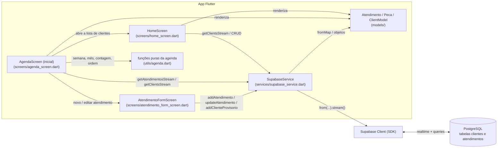

# Documento de Arquitetura e Decisões Técnicas - SGC para MSClean

## 1. Introdução
Este documento detalha a arquitetura de software, a stack de tecnologia (conjunto de tecnologias) e as decisões técnicas tomadas para o desenvolvimento do Sistema de Gestão de Clientes (SGC) da MSClean.

A stack oficial é **Flutter + Supabase**, confirmada na auditoria inicial (`docs/AUDITORIA_INICIAL.md`). Versões anteriores deste documento descreviam Firebase; essa divergência foi corrigida aqui.

## 2. Visão Geral da Arquitetura
O sistema segue um modelo **Cliente-Servidor (Backend as a Service)**. Um front-end multiplataforma se comunica com um serviço de backend gerenciado, eliminando a necessidade de construir e operar um servidor customizado.

* **Front-end (Cliente):** Um aplicativo Flutter que roda em Android e na Web.
* **Backend (BaaS):** O **Supabase**, responsável pelo banco de dados PostgreSQL gerenciado, sincronização em tempo real (realtime) e autorização via Row Level Security (RLS).

**Fluxo de Dados:**
```
[App Android / Web]  <==>  [Supabase Client]  <==>  [PostgreSQL (Supabase)]
```
O app não fala diretamente com o banco: o **Supabase Client** (SDK no Flutter) intermedia toda leitura e escrita, abre a stream de tempo real e carrega a `anonKey` pública. As regras de RLS no PostgreSQL determinam o que essa chave pode acessar.

## 3. Stack de Tecnologia
-   **Linguagem de Programação:** **Dart**. Por ser a linguagem oficial do Flutter, oferece alta performance e um ecossistema robusto.
-   **Framework Front-end:** **Flutter**. Escolhido por sua capacidade de compilar para múltiplas plataformas (Android e Web) a partir de um único código-fonte, acelerando o desenvolvimento e garantindo consistência de interface.
-   **Backend / Banco de Dados:** **Supabase**. Utilizado como BaaS para gerenciar:
    -   **PostgreSQL gerenciado:** banco relacional maduro, com schema explícito e consultas SQL — sem a necessidade de provisionar ou manter servidor de banco.
    -   **Realtime nativo:** alterações na tabela são entregues ao app por streams, sustentando a sincronização em tempo real exigida pelo RNF-004.
    -   **Row Level Security (RLS):** a autorização vive no banco. Como o cliente expõe apenas a `anonKey` pública, são as políticas de RLS que garantem o acesso seguro aos dados (RNF-005).
    -   **Alternativa open-source ao Firebase:** evita lock-in de fornecedor; o Postgres por baixo é portável e padrão de mercado.

## 4. Estrutura do Banco de Dados (PostgreSQL / Supabase)
O banco é relacional, organizado em tabelas.

* **Tabela:** `clientes`
* **Colunas (baseado em `client_model.dart`):**
    -   `id` (uuid / chave primária, gerado pelo Supabase)
    -   `nome` (text)
    -   `endereco` (**jsonb**, opcional — endereço estruturado, issue #65): objeto com as chaves `logradouro`, `numero`, `bairro`, `complemento` e `referencia` (todas text; ausência de qualquer chave é lida como vazio). Modela casa/apartamento/condomínio num só formato e alimenta o resumo da lista, a busca e a consulta ao mapa. Sem chaves de CEP/cidade: a área de atendimento é só Campo Grande - MS, âncora fixa (`Endereco.cidadeFixa`) na consulta ao Maps. Era `text` até a issue #61.
    -   `telefones` (text[] — um ou mais números por cliente, issue #62)

A tabela é lida via stream ordenada por `nome`. O mapeamento jsonb ⇄ objeto vive no value object `Endereco` (`lib/models/endereco.dart`), aninhado em `ClientModel`.

* **Tabela:** `atendimentos` (RF-010, issue #75)
* **Colunas (baseado em `atendimento.dart`):**
    -   `id` (uuid / chave primária, gerado pelo Supabase)
    -   `data` (date, obrigatória — o dia da agenda; sem fuso, porque a agenda é por dia e não por instante)
    -   `periodo` (text, obrigatório — `'manha'` ou `'tarde'`, com `check`; é o eixo de agrupamento do dia)
    -   `hora` (time, opcional — a proprietária quase nunca anota hora; quando anota, ordena dentro do período)
    -   `cliente_id` (uuid, obrigatório — FK para `clientes.id` com `on delete cascade`: excluir um cliente leva os atendimentos dele; a alternativa `restrict` bloquearia a exclusão de qualquer cliente já atendido, o que não existe na agenda de papel)
    -   `local` (text, opcional — endereço do serviço quando não é o do cadastro)
    -   `pecas` (**jsonb**, lista — cada peça é `{ "tipo", "quantidade", "largura", "comprimento" }`, mesmo molde do `endereco`; o mapeamento vive no value object `Peca`, `lib/models/peca.dart`)
    -   `valor` (numeric, opcional — valor combinado)
    -   `criado_em` (timestamptz, `default now()` — desempata os atendimentos sem hora: ficam na ordem em que foram registrados)

A tabela é lida via stream ordenada por `data`; o agrupamento por período, a contagem por dia e a ordem dentro do período são calculados no app (`lib/utils/agenda.dart`), porque a stream já traz todos os atendimentos em memória — mesmo raciocínio da busca client-side (§7). Os campos de conclusão (feito/pago, RF-014) e observação (RF-005) entram por `alter table` nas suas entregas. A escrita (RF-005, #77) usa `insert` e `update` pela chave primária, com o mapa de `Atendimento.toMap()`; não exigiu mudança de schema.

**Cliente provisório (RF-005) sem coluna nova.** O registro pela agenda pode criar um cliente só com o nome; como o cadastro (RF-001) exige ao menos um telefone, a marca de provisório é `telefones` vazio (`ClientModel.provisorio`). Completar o cadastro pela edição, que continua exigindo telefone, é o que apaga a marca. A alternativa (coluna `provisorio boolean`) exigiria migração e um segundo lugar para manter coerente.

SQL aplicado no painel do Supabase (não há pasta de migrations — ver `CLAUDE.md`):

```sql
create table public.atendimentos (
  id         uuid primary key default gen_random_uuid(),
  data       date not null,
  periodo    text not null check (periodo in ('manha', 'tarde')),
  hora       time,
  cliente_id uuid not null references public.clientes (id) on delete cascade,
  local      text,
  pecas      jsonb not null default '[]'::jsonb,
  valor      numeric,
  criado_em  timestamptz not null default now()
);

create index atendimentos_data_idx on public.atendimentos (data);

alter table public.atendimentos enable row level security;

create policy mvp_acesso_total_anon on public.atendimentos
  for all to anon using (true) with check (true);

-- a stream do app depende da publicação de realtime
alter publication supabase_realtime add table public.atendimentos;
```

**Row Level Security.** As tabelas `clientes` e `atendimentos` têm RLS habilitada, cada uma com uma única política de mesmo nome: `mvp_acesso_total_anon` (`FOR ALL`, role `anon`, `USING (true)` e `WITH CHECK (true)`). Na prática, com o RLS ligado, a role `anon` — a mesma que a `anonKey` pública carregada pelo app assume — tem acesso total de leitura e escrita às tabelas, sem nenhum filtro por linha. Essa permissividade é **deliberada** para o estágio atual (usuária única, app ainda não distribuído publicamente) e tem prazo de validade: deve ser substituída por políticas restritivas quando o RF-007 (autenticação) for implementado. Ver as dívidas técnicas (seção 9) e os riscos (seção 10).

## 5. Estrutura de Diretórios do Projeto
A organização real do código:
```
lib/
├── main.dart                       # inicializa o app e o Supabase via .env; abre na AgendaScreen
├── models/
│   ├── atendimento.dart            # Atendimento e Periodo (manhã/tarde): a linha da agenda
│   ├── peca.dart                   # Peca: value object das peças do serviço (jsonb), com o resumo do cartão
│   ├── client_model.dart           # ClientModel: id, nome, endereco (Endereco), telefones
│   └── endereco.dart               # Endereco: value object do endereço estruturado (jsonb)
├── screens/
│   ├── agenda_screen.dart          # tela inicial (RF-010): dia por período, faixa da semana, mês em calendário
│   ├── atendimento_form_screen.dart # registro e edição de atendimento a partir do dia (RF-005)
│   ├── home_screen.dart            # lista de clientes + barra de busca (aberta a partir da agenda)
│   └── client_form_screen.dart     # formulário de cadastro (RF-001; reusável na edição)
├── services/
│   ├── supabase_service.dart       # acesso ao Supabase (streams de clientes e atendimentos + escrita de clientes e atendimentos)
│   └── maps_launcher.dart          # abre o endereco no Google Maps (RF-009, url_launcher)
├── theme/
│   ├── app_colors.dart             # paleta (contrastes WCAG medidos em comentário)
│   ├── app_spacing.dart            # AppSpacing (escala de 4) e AppRadius
│   ├── app_typography.dart         # TextTheme em Archivo, os seis tokens de texto
│   └── app_theme.dart              # ColorScheme explícito + ThemeData (AppTheme.claro)
└── utils/
    ├── agenda.dart                 # funções puras da agenda: semana, grade do mês, contagem, ordem do dia, nomes em PT-BR, valor em reais
    └── validators.dart             # validações puras dos formulários (obrigatório, telefone, hora)
```
Fora de `lib/`: `docs/` (esta documentação e os requisitos) e `test/` (testes).

## 6. Diagrama de Componentes
Relação entre as camadas do app e o backend:



Em texto: a **AgendaScreen** é a tela inicial e consome as duas streams do **service** (atendimentos e clientes, esta para resolver o nome de cada atendimento); as regras de calendário e de ordem do dia ficam em **funções puras** (`utils/agenda.dart`), testadas sem widget. O **AtendimentoFormScreen** abre a partir da agenda (novo, no dia selecionado, ou edição de um cartão), recebe a lista de clientes já carregada e grava pelo service; ao voltar, a agenda renova a sua stream. A **HomeScreen** (lista de clientes) abre a partir da agenda. O service conversa com o **Supabase client**, que lê/escreve no **PostgreSQL**; os dados trafegam mapeados para os **models**, que as screens renderizam.

## 7. Decisões Técnicas e Justificativas

* **Por que Supabase e não Firebase.** Decisão histórica registrada em `docs/AUDITORIA_INICIAL.md`: o commit de "reconstrução da base com supabase" trocou o backend, mas a documentação só foi sincronizada agora. Supabase entrega PostgreSQL gerenciado (schema explícito e SQL padrão), realtime nativo e RLS para autorização, além de ser uma alternativa open-source que evita lock-in. Firebase fica fora do projeto.

* **Por que `setState` e não Provider/Riverpod neste estágio.** O escopo é pequeno (uma tela, estado local de busca e a stream de clientes). `setState` cobre essa necessidade sem introduzir uma camada de gerência de estado — evitar overengineering. Quando o app crescer (múltiplas telas compartilhando estado, navegação com dependências), a decisão será reavaliada em favor de uma solução como Provider/Riverpod.

  *Reavaliação na entrega da agenda (RF-010, #75):* a decisão continua valendo. A agenda e a lista de clientes não compartilham estado — cada tela abre as suas streams e o Supabase é a única fonte da verdade; o que a agenda guarda (`dia selecionado`, `mês exibido`, `vista dia/mês`) é estado de navegação local, que morre com a tela. A agenda substitui os `StreamBuilder` aninhados por duas assinaturas abertas no `initState`, para que o primeiro quadro com dados já traga atendimentos e nomes de clientes de uma vez. O gatilho para rever de novo é o RF-005/RF-014: se o formulário de atendimento e as marcas de feito/pago passarem a exigir que a agenda reaja a mudanças feitas noutra tela sem depender do realtime (cuja entrega de UPDATE é o problema conhecido da issue #57), aí entra uma solução de estado compartilhado.

* **Por que a agenda calcula semana, mês e ordem no app, e não no SQL.** A stream de `atendimentos` já traz a tabela inteira ordenada por `data` (volume pequeno: uma prestadora, poucos atendimentos por dia). Semana, grade do mês, contagem por dia e ordem dentro do período são funções puras em `lib/utils/agenda.dart`, que recebem a lista e o "hoje" por parâmetro — testáveis sem Supabase e sem relógio real (`agenda_test`). A alternativa (uma view ou RPC por período) adicionaria ida e volta ao servidor a cada navegação de dia, sem ganho no volume atual. A semana vai de domingo a sábado, como o calendário de parede; a confirmação com a proprietária fica para a verificação manual.

* **Por que busca client-side.** O volume de dados é pequeno (uma prestadora, base na casa das dezenas/centenas de clientes) e a stream já traz a lista completa em memória; filtrar no cliente dá UX em tempo real, sem ida e volta ao servidor a cada tecla. Isso muda quando a base crescer a ponto de não ser razoável manter tudo em memória ou quando a latência incomodar — aí a busca passa a ser feita no servidor (query/filtro no Postgres, ex.: `ilike`/full-text search).

* **Por que a URL do mapa é separada do disparo.** Em `maps_launcher.dart`, a
  montagem da URL do Google Maps (`urlMaps`) é uma função pura, testável sem o
  plugin; só o `abrirEnderecoNoMaps` toca o `url_launcher`. A abertura é
  injetável na `HomeScreen` (parâmetro `abrirMaps`), então o teste de widget
  verifica o disparo sem mockar o canal nativo do plugin. Usa uma URL de busca
  universal (`google.com/maps/search/?api=1&query=`), que funciona em Android e
  web sem código específico de plataforma.

* **Por que um design system em `lib/theme/` antes das telas da agenda.** O estilo vinha sendo decidido tela a tela, com hex literal dentro do widget — o `main.dart` declarava um `ThemeData` escuro que não vinha de lugar nenhum, e as duas telas existentes acumulam nove cores hardcoded. Escrever as seis telas da agenda por cima disso multiplicaria a dívida. Os tokens estão especificados em `docs/design-system.md`, mas a **fonte da verdade é o Dart**: o documento é vista dele. Manter duas definições independentes da mesma coisa termina sempre com as duas divergindo, e a divergência só aparece tarde. A alternativa descartada foi seguir direto para o código da agenda e padronizar depois: economizaria este PR e cobraria o retrofit de seis telas em vez de duas.

* **Por que `ColorScheme` explícito e não `ColorScheme.fromSeed`.** O `fromSeed` deriva as trinta e tantas cores do esquema de uma única semente, pelo algoritmo tonal do Material 3. A paleta do projeto foi escolhida à mão e **medida** par a par contra a WCAG 2.1 AA — três cores do protótipo foram corrigidas justamente por reprovarem. Uma semente descartaria essas medições e devolveria tons derivados que ninguém verificou. O custo assumido é manutenção manual: acrescentar uma cor exige decidir em que slot ela entra, ou se fica fora do esquema. Duas cores de papel — `tarde` e `sucesso` — ficam de fora por decisão: significam período do dia e serviço concluído, e não nível de hierarquia Material; vivem em `AppColors` e `secondary`/`tertiary` espelham a primária, para que um widget que peça `tertiary` por acidente receba a paleta principal em vez de um verde que mentiria sobre o estado do atendimento.

* **Por que só tema claro.** O app é claro, derivado do protótipo navegável da agenda. Um tema escuro exigiria medir a paleta inteira de novo contra fundos escuros — todos os contrastes registrados valem para superfícies claras — e não há demanda da usuária. A alternativa (`ThemeMode.system` com dois esquemas) dobraria a superfície a manter e a verificar em troca de nada que tenha sido pedido.

* **Por que Figma fica fora do projeto.** A especificação visual vive no repositório, em `docs/design-system.md` e em `lib/theme/`, versionada junto do código e revisada no mesmo PR. Uma ferramenta de design externa acrescentaria uma terceira definição dos mesmos tokens, fora do controle de versão do projeto e sem ninguém para mantê-la sincronizada — o projeto tem desenvolvedor solo e usuária única.

* **Por que sem camada de repository.** Com uma única fonte de dados (Supabase) e operações CRUD diretas, uma camada de `repositories/` adicionaria indireção sem benefício no escopo do MVP. O `SupabaseService` já isola o acesso ao backend. A camada pode ser introduzida se surgirem múltiplas fontes de dados, cache local ou necessidade de trocar o backend sem tocar nas telas.

## 8. Estratégia de Testes
A auditoria registrou cobertura real de 0% — o único teste era o template padrão do Flutter, que falha porque procura widgets inexistentes neste app. A estratégia a partir daqui:

* **Remoção do template quebrado:** substituir `test/widget_test.dart` (smoke test do contador) por testes que cobrem o app real.
* **Teste antes da feature:** conforme decisão da auditoria, o plano de testes precede a implementação de cada feature do MVP.
* **Testes unitários (models/services):** validar `ClientModel.fromMap` (incl. campos ausentes/nulos) e a lógica de filtro do `SupabaseService` (case-insensitive, busca por nome ou endereço, resultado vazio), com o cliente Supabase mockado.
* **Testes de widget (telas):** verificar os estados da `HomeScreen` — carregando, lista vazia ("Nenhum cliente encontrado."), lista populada e filtragem ao digitar na busca.
* **Critérios de aceitação como base:** cada teste rastreia um critério verificável da seção 2 de `requisitos.md` (ex.: campos obrigatórios no cadastro, confirmação antes de excluir).
* **Guardas de consistência:** além dos testes que rastreiam critérios de aceitação, a suíte tem testes que verificam regras do próprio projeto lendo o código-fonte. O primeiro é `design_system_test`, que falha se alguma tela em `lib/screens/` declarar `Color(0x...)` ou `Colors.*` em vez de usar o tema ou `AppColors` (`design-system.md` §6). O motivo é que regra de estilo sem automação não sobrevive: a revisão humana não pega uma cor literal a mais no meio de um diff grande, e o custo de descobrir tarde é o retrofit de todas as telas de novo.
* **Meta:** nenhuma feature do MVP é considerada pronta sem teste correspondente; o objetivo é manter a suíte verde no CI (sem testes que falham por estarem desatualizados).

## 9. Dívidas Técnicas Conhecidas

| Item | Razão | Quando reavaliar |
|---|---|---|
| Sem autenticação no MVP | Usuária única no próprio dispositivo; RLS é o controle de segurança | Quando houver mais de um usuário ou necessidade de auditoria |
| Busca client-side | Volume pequeno justifica filtrar em memória; UX em tempo real sem ida ao servidor | Quando a base ultrapassar ~500 clientes ou latência incomodar |
| Sem camada de repository | Escopo MVP com fonte única (Supabase) não justifica indireção | Quando surgir cache local, múltiplas fontes ou troca de backend |
| Tabela `clientes` em português | Decisão histórica do código atual; refactor envolve renomear tabela, ajustar service e migrar dados | Em refactor futuro com padronização para inglês |
| RLS deliberadamente permissiva | Política `mvp_acesso_total_anon` dá acesso total à role `anon` (`USING/WITH CHECK (true)`); aceitável só enquanto o app tem usuária única e não é distribuído | Ao implementar o RF-007 (autenticação): trocar por políticas restritivas por usuário |
| `.env.example` ausente | Quem clona o repositório não sabe quais chaves preencher | Próximo passo imediato (já listado na auditoria) |
| `pubspec.yaml` com descrição genérica | Ainda está com o placeholder "A new Flutter project." | Junto com a criação do .env.example |
| `print()` em produção | Usado em home_screen para o onTap; saída sem propósito de log | No refactor da tela de detalhes (RF futuro) |

## 10. Riscos e Mitigações

| Risco | Probabilidade | Impacto | Mitigação |
|---|---|---|---|
| Política de RLS permissiva expor dados de clientes | Média | Alto | Risco residual conhecido: com a `mvp_acesso_total_anon`, qualquer um de posse da `anonKey` tem acesso total à tabela. Mitigação real: não distribuir a `anonKey` amplamente (app não publicado) até o RF-007 substituir a política por regras restritivas |
| Crescimento da base degradar a busca client-side | Baixa (curto prazo) | Médio | Monitorar volume; migrar para busca server-side (ilike/full-text) quando ultrapassar limiar de ~500 registros |
| Perda do `.env` por falta de exemplo no repositório | Alta | Médio | Criar `.env.example` com chaves esperadas e instruções |
| Documentação voltar a divergir do código | Média | Médio | Definição de pronto inclui atualização de docs; revisão a cada commit que mexer em model, stack ou estrutura |
| Cobertura zero permitir regressões silenciosas | Alta (hoje) | Alto | Substituir template de teste; plano de testes precede cada feature do MVP (ver seção 8) |
| Projeto Supabase (plano gratuito) pausar por inatividade | Alta em períodos sem desenvolvimento (aconteceu em 2026-07 e em 2026-10/11) | Médio: o app abre sem dados até a retomada manual pelo painel; os dados não se perdem (restaurável por meses) | Workflow `keep-alive.yml` faz uma leitura mínima na API REST todo dia (issue #72); credenciais em secrets do repositório. Quando a usuária estiver em uso diário, o próprio uso mantém o projeto ativo |

## 11. Histórico de Versões

| Data | Versão | Autor | Descrição da mudança |
|---|---|---|---|
| 2025-09-11 | 1.0 | Wilson Gorosthides | Versão inicial (descrevia Firebase) |
| 2026-06-27 | 2.0 | Wilson Gorosthides | Sincronização com auditoria: Supabase, model real, justificativas técnicas, estratégia de testes |
| 2026-06-27 | 2.1 | Wilson Gorosthides | Adição das seções de dívidas técnicas, riscos e histórico de versões |
| 2026-07-08 | 2.2 | Wilson Gorosthides | Documentação da política de RLS `mvp_acesso_total_anon` (verificada em produção, deliberadamente permissiva até o RF-007) nas seções 4, 9 e 10 |
| 2026-07-15 | 2.3 | Wilson Gorosthides | Atualiza a estrutura de diretórios (§5) com o RF-001: `client_form_screen.dart`, `utils/validators.dart` e o insert no service |
| 2026-07-21 | 2.4 | Wilson Gorosthides | Schema da tabela `clientes` (§4): `endereco` passa a opcional (#61) e `telefone` (text) vira `telefones` (text[], um ou mais números por cliente, #62); árvore §5 atualizada. Requer migração no Supabase. |
| 2026-07-21 | 2.6 | Wilson Gorosthides | Novo `lib/services/maps_launcher.dart` na árvore §5 e decisão técnica (§7): URL do Google Maps montada por função pura, disparo via `url_launcher` injetável na `HomeScreen` (RF-009, issue #66). |
| 2026-07-21 | 2.5 | Wilson Gorosthides | Schema da tabela `clientes` (§4): `endereco` passa de text para **jsonb** com endereço estruturado (logradouro, número, bairro, complemento, referência; sem CEP/cidade — área de atendimento fixa em Campo Grande - MS); novo value object `Endereco` (`lib/models/endereco.dart`) na árvore §5. Requer migração no Supabase (text → jsonb, issue #65). |
| 2026-09-23 | 2.7 | Wilson Gorosthides | Novo `lib/theme/` na árvore §5 (`app_colors`, `app_spacing`, `app_typography`, `app_theme`) e quatro decisões técnicas em §7: design system antes das telas da agenda, `ColorScheme` explícito em vez de `fromSeed`, só tema claro e Figma fora do projeto. Tokens especificados em `docs/design-system.md` (issue #60). |
| 2026-11-12 | 2.9 | Wilson Gorosthides | §10: novo risco de pausa do projeto Supabase por inatividade, mitigado pelo workflow `keep-alive.yml` (leitura diária na API REST, issue #72). |
| 2026-10-06 | 2.8 | Wilson Gorosthides | §8 registra a categoria de "guardas de consistência" na estratégia de testes, com o `design_system_test` (nenhuma cor literal em `lib/screens/`) como primeiro caso. Issue #60. |
| 2026-11-13 | 2.11 | Wilson Gorosthides | Registro de atendimento (RF-005 enxuto, issue #77): §4 registra a escrita em `atendimentos` sem mudança de schema e a decisão do cliente provisório sem coluna nova (`telefones` vazio); árvore §5 com `atendimento_form_screen.dart`; diagrama §6 com o formulário e as escritas pelo service. |
| 2026-11-13 | 2.10 | Wilson Gorosthides | Agenda como tela inicial (RF-010, issue #75): tabela `atendimentos` na §4 (colunas, FK com cascade, `pecas` em jsonb, SQL com RLS e publicação de realtime); árvore §5 com `agenda_screen`, `atendimento`, `peca` e `utils/agenda`; diagrama §6 com a `AgendaScreen` inicial e as duas tabelas; §7 reavalia e mantém o `setState` e registra a decisão de calcular semana, mês e ordem no app; §12 cita a nova tabela. |

## 12. Ambiente de Desenvolvimento
Os seguintes softwares e configurações são necessários para iniciar o desenvolvimento:
-   Flutter SDK
-   Editor de código (Visual Studio Code ou Android Studio)
-   Conta no **Supabase** com o projeto e as tabelas `clientes` e `atendimentos` configuradas (incl. políticas de RLS e, para `atendimentos`, a publicação de realtime — SQL na §4)
-   Arquivo `.env` na raiz do app com `SUPABASE_URL` e `SUPABASE_ANON_KEY` (use o `.env.example` como referência; o `.env` real fica fora do controle de versão)
